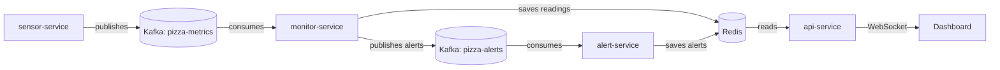

# Pizza Monitor

A small event-driven learning project: pizzeria "sensors" publish metrics to **Kafka**, a monitor stores them in **Redis** and detects incidents, an alert service handles notifications, and an API pushes live data to a web dashboard over REST and WebSocket.



**To understand how Kafka and Redis work, read [docs/KAFKA-REDIS.md](KAFKA-REDIS.md).**

## Modules

| Module | Role | Kafka | Redis |
|---|---|---|---|
| `common` | models, topic names, Redis keys, `PizzaRedisRepository` | - | all Redis access |
| `sensor-service` | generates metrics | producer → `pizza-metrics` | - |
| `monitor-service` | stores metrics, detects incidents | consumer of `pizza-metrics`, producer → `pizza-alerts` | writes metrics, anti-spam lock |
| `alert-service` | "notifications" | consumer of `pizza-alerts` | writes alerts |
| `api-service` | REST + WebSocket + dashboard | - | reads |

## Getting started

Requirements: JDK 17+, Docker with Compose v2.

```bash
docker compose up -d --wait        # Kafka, Zookeeper, Redis, Kafka UI, RedisInsight

# one service per terminal
./gradlew :sensor-service:bootRun
./gradlew :monitor-service:bootRun
./gradlew :alert-service:bootRun
./gradlew :api-service:bootRun
```

- Dashboard: http://localhost:3000
- Kafka UI: http://localhost:8080
- RedisInsight: http://localhost:5540 (Add database → host `redis`, port `6379`)

Stop with `Ctrl+C` in each terminal, then `docker compose down`.

Tests: `./gradlew test`.

## Configuration (environment variables)

| Variable | Default | Description |
|---|---|---|
| `KAFKA_BROKERS` | `localhost:9092` | Comma-separated broker list |
| `REDIS_URL` | `redis://localhost:6379` | Redis connection URL |
| `PORT` | `3000` | API and dashboard port |
| `SENSOR_INTERVAL_MS` | `3000` | How often sensors publish metrics |
| `BROADCAST_INTERVAL_MS` | `2000` | How often the API pushes updates to the dashboard |
| `ALERT_COOLDOWN` | `30s` | Minimum interval between identical alerts |
| `ALERT_BELL` | `false` | `1` rings the terminal bell on alerts |

Example: `SENSOR_INTERVAL_MS=500 ./gradlew :sensor-service:bootRun`

## HTTP API

| Endpoint | Description |
|---|---|
| `GET /api/health` | Service and Redis status |
| `GET /api/pizzerias` | Latest metrics for every pizzeria |
| `GET /api/pizzerias/{id}/history?limit=50` | Metric history (up to 100 entries) |
| `GET /api/alerts` | Most recent alerts |
| `ws://localhost:3000/ws` | WebSocket: snapshot every 2 s |
